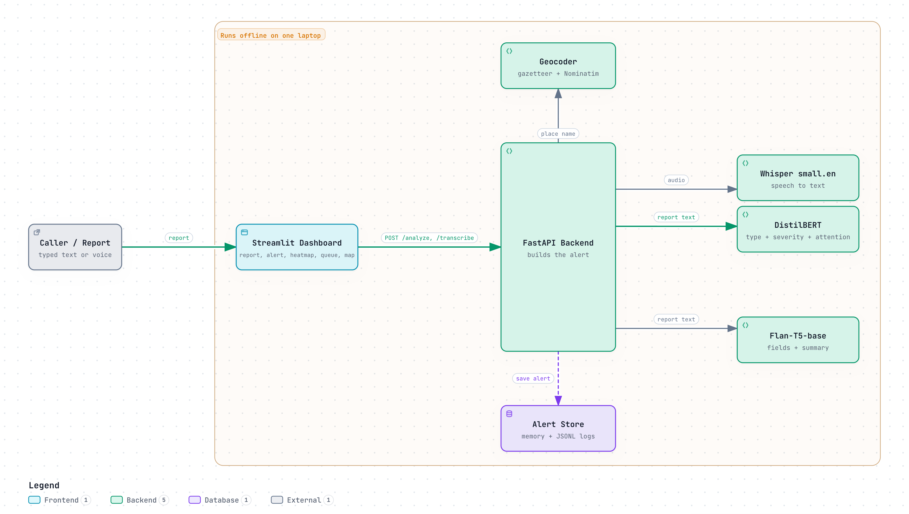
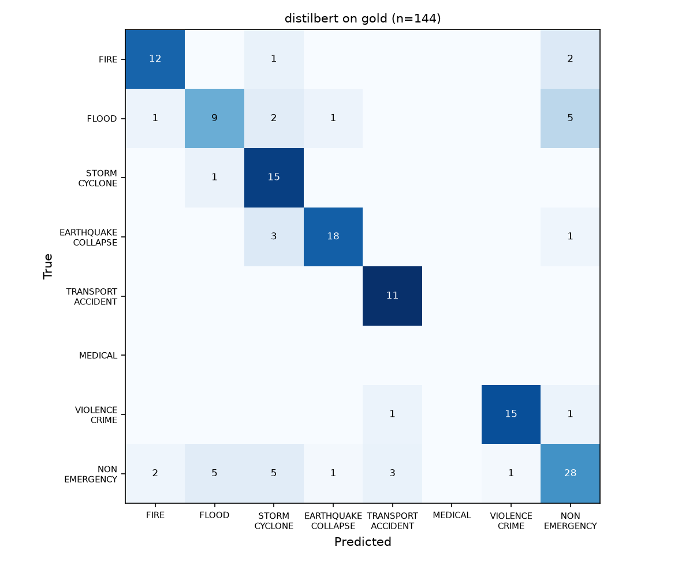

# ResQPulse AI

**Turn a messy emergency report, typed or spoken, into a structured, prioritised, explainable alert, on a laptop and offline.**

[](https://github.com/GgauravJ05/ResQPulse-AI/actions/workflows/ci.yml)

[](LICENSE)
[](https://www.kaggle.com/datasets/ggauravj05/resqpulse-data)

<p align="center"></p>

A caller says: *"bhai there's a huge fire near the petrol pump on FC road, 2-3 people stuck inside the shop, smoke everywhere."*
ResQPulse turns that into an alert with the incident type, a severity score, the location, people affected, injuries,
hazards and the responders to send; highlights the words behind the decision; pins it on a map; and ranks it in a
dispatcher's queue. **A person confirms every alert.**

Built at **GenHack v1.0** (Gen AI course, problem statement 15 *EmergencyScribe*, technique: Transformer + Attention) by
[Team P 25](#team).

> **Research prototype.** Not certified for real emergency dispatch. See [Limitations](#limitations) and [SECURITY.md](SECURITY.md).

---

## Contents

- [Highlights](#highlights)
- [How it works](#how-it-works)
- [Results](#results)
- [Limitations](#limitations)
- [Quick start](#quick-start)
- [Data](#data)
- [Models](#models)
- [Reproducing the results](#reproducing-the-results)
- [Using the dashboard](#using-the-dashboard)
- [API](#api)
- [Repository structure](#repository-structure)
- [Documentation](#documentation)
- [Team](#team)
- [Credits and citation](#credits-and-citation)
- [License](#license)

---

## Highlights

- **A full alert, not a label:** incident type (8 classes), continuous severity 1–5, location, people affected, injuries, hazards, summary, responders, UN SDG targets.
- **Explainable:** an attention-rollout heatmap shows which words drove each decision.
- **Voice in:** Whisper transcribes calls; the dispatcher can correct the transcript before it becomes an alert.
- **Duplicate flagging:** reworded reports of the same incident are linked, so ten calls about one fire are not ten alerts.
- **Offline and small:** DistilBERT, Flan-T5-base and Whisper small run on a laptop CPU, about 2–4 s per report.
- **Honest evaluation:** one script, held-out data, a baseline on every table, and a 144-report human-audited gold set.

## How it works

```
typed report ─────────────────────────────┐
                                          ├─► DistilBERT ──► incident type + severity + attention ─┐
voice call ──► Whisper (speech → text) ───┘                                                        ├─► FastAPI ─► one JSON alert ─► Streamlit dashboard
                                          └─► Flan-T5 ─────► location, people, injuries,          │     │        (alert card, heatmap,
                                                             hazards, summary                      ┘     │         queue, map)
                                                  geocoding · responder rules · SDG tags · duplicate check
```

| Component | Model / tool | Role |
|---|---|---|
| Classifier | `distilbert-base-uncased`, fine-tuned with **two heads** | Incident type (cross-entropy) + severity (masked MSE); attention rollout for the heatmap |
| Generator | `google/flan-t5-base`, fine-tuned (fp32) | Writes `location: … \| people: … \| injuries: … \| hazards: … \| summary: …`, parsed to JSON; retry with a wider beam, then a rule-based fallback |
| Speech | `faster-whisper` `small.en` (int8, VAD) | Transcription with a confidence flag |
| Duplicates | `all-MiniLM-L6-v2` | Cosine similarity > 0.75 marks `duplicate_of` |
| Baseline | TF-IDF + logistic regression | The no-deep-learning comparison |
| Backend / UI | FastAPI · Streamlit · Folium | API, dashboard, incident map |

Training ran on free Kaggle T4 GPUs ([notebooks/](notebooks/)); inference runs on CPU.

## Results

All scores come from [scripts/evaluate.py](scripts/evaluate.py) on data the models never saw. Full tables:
[reports/results.md](reports/results.md).

**Incident type: baseline (TF-IDF + logistic regression) → DistilBERT**

| Test set | Macro precision | Macro recall | Macro F1 |
|---|---|---|---|
| **Gold: 144 real reports, human-audited labels** | 0.61 → **0.76** | 0.59 → **0.79** | 0.56 → **0.77** |
| Call-style: 107 reports | 0.89 → **0.96** | 0.86 → **0.96** | 0.87 → **0.96** |
| Real tweets: 7,755 (incl. 6 crises never seen) | 0.73 → **0.79** | 0.62 → **0.75** | 0.63 → **0.75** |

On the 6 crises held out entirely, accuracy is **64% vs 48%** for the baseline.

**Safety on the gold set** (a missed emergency costs more than a false alarm)

| | Baseline | DistilBERT |
|---|---|---|
| Real emergencies caught (of 99) | 70 (0.71) | **90 (0.91)** |
| Severity 4–5 reports dismissed as non-emergency (of 56) | 14 | **1** |
| False alarms on non-emergencies | 0.36 | 0.38 |

**Severity (1–5):** RMSE **0.75** / MSE 0.57 on call-style reports (87% within one point); RMSE 1.33 on real tweets.
**Extraction (Flan-T5):** parses 100% of the time; location F1 0.78, injuries F1 0.54 (0.64 lenient), summary ROUGE-L 0.50 on call-style reports.
**Voice:** word error rate 9.9% clean / 15.5% noisy on 20 synthetic-voice clips ([reports/whisper_wer.json](reports/whisper_wer.json)).

<p align="center"></p>

Things we tried that did **not** help, and kept out: moving the emergency threshold (false alarms 0.38 → 0.31 cost
emergency recall 0.93 → 0.87), and averaging with the baseline (gold macro F1 unchanged or lower).

## Limitations

- **False alarms:** 37.8% of non-emergency tweets in the gold set are flagged; the model reads the topic, not the intent. The human dispatcher is the safeguard.
- **Severity on real tweets is weaker** (RMSE 1.33): the severity head was trained on call-style reports only.
- **No real 112 calls:** everyday emergencies rely on generated reports; `MEDICAL` has no real tweets.
- **Gold labels** were drafted by an LLM, re-reviewed, and audited by a person on 30 random rows (30/30 agreed); they are not hand-labelled throughout.
- **Voice** was measured on synthetic speech (20 clips), not real callers.
- **English only.** Attention is an indicator of focus, not proof of reasoning.

## Quick start

Requirements: **Python 3.10+** and **ffmpeg** (`brew install ffmpeg`, `sudo apt install ffmpeg` or `winget install ffmpeg`).

```bash
git clone https://github.com/GgauravJ05/ResQPulse-AI.git
cd ResQPulse-AI
python3 -m venv .venv && source .venv/bin/activate      # Windows: .venv\Scripts\activate
pip install -r requirements.txt
cp .env.example .env
```

**Try it without any model weights** (fake models, real UI and API):

```bash
make api-fake        # terminal 1: backend on :8000
make ui              # terminal 2: dashboard on http://localhost:8501
```

**Run with the real models:** put the trained weights in `models/` (see [Models](#models)), then:

```bash
make api             # USE_FAKE_MODELS=false; wait for "Application startup complete"
make ui
curl http://localhost:8000/health   # {"status":"ok","models":{"classifier":true,"generator":true,"asr":true}}
```

Start the backend first; the dashboard uses live mode only if the backend answers. Whisper (~480 MB) and MiniLM
(~90 MB) download on first use, after which everything runs offline. `make help` lists all commands.

## Data

No public dataset of emergency calls with these labels exists, so we built one.

| Part | Source | In this repo? |
|---|---|---|
| Real disaster tweets (~37,000 after cleaning) | [HumAID](https://crisisnlp.qcri.org/humaid_dataset), [CrisisLexT26](https://crisislex.org/data-collections.html), [Kaggle Disaster Tweets](https://www.kaggle.com/competitions/nlp-getting-started) | **No.** Download from the sources; their terms do not allow redistributing tweet text |
| 710 call-style reports, fully labelled | Generated for this project, validated so every extracted phrase appears verbatim | **Yes**, `data/raw/synthetic/` (CC BY 4.0) |
| 144-report gold test set | Real held-out tweets; labels drafted by an LLM, re-reviewed, human-audited | **Labels only**, `data/gold/gold_labels.csv`; text rebuilt by ID |

**Kaggle:** the public release (synthetic reports, generator pairs, and tweet labels by ID) is at
[kaggle.com/datasets/ggauravj05/resqpulse-data](https://www.kaggle.com/datasets/ggauravj05/resqpulse-data). Build it
yourself with `make public-dataset`; the Kaggle page text lives in [docs/KAGGLE_DATACARD.md](docs/KAGGLE_DATACARD.md), and
`make kaggle-release` uploads the release with that text.

**Rebuild everything from the sources:**
1. Download into `data/raw/`: HumAID events set 1 → `data/raw/events_set1/`, CrisisLexT26 → `data/raw/CrisisLexT26/`, Kaggle `train.csv` → `data/raw/kaggle_disaster/` (links and exact layout in [docs/DATASETS.md](docs/DATASETS.md)).
2. `make data` → validates the synthetic reports, cleans the tweets and builds the train / val / test splits (6 crises held out, 1,200-per-class cap, synthetic rows ×4)
3. `make gold` → rebuilds the gold set's text from the test split by ID

Schema (8 incident types, severity rubric, alert fields, API contract): [docs/SCHEMA.md](docs/SCHEMA.md).

## Models

Trained weights are **not in git** (~1.2 GB). The app expects:

```
models/classifier/   config.json, model.safetensors, heads.pt, label_map.json, tokenizer files   (DistilBERT, two heads)
models/generator/    config.json, generation_config.json, model.safetensors, tokenizer files     (Flan-T5-base)
```

To train them yourself (free Kaggle T4 GPU): run [notebooks/classifier-notebook.ipynb](notebooks/classifier-notebook.ipynb)
(or `scripts/train_classifier.py`; lr 2e-5, 3 epochs, batch 32, max length 128) and
[notebooks/flan-t5-train.ipynb](notebooks/flan-t5-train.ipynb) (lr 1e-4, 5 epochs, effective batch 16, fp32), then copy
the output folders into `models/`. Folder paths can be changed in `.env`.

## Reproducing the results

```bash
make test                                           # 52 tests (model-dependent ones skip if weights are absent)
python scripts/baseline_tfidf_lr.py --help          # TF-IDF + logistic regression baseline
python scripts/predict_generator.py --out predictions   # the real extraction pipeline on the test sets
make eval                                           # scores predictions/*.csv → reports/
python scripts/eval_whisper.py --n 20               # voice word error rate (backend running; macOS `say`)
```

Prediction file formats: [docs/SCHEMA.md §8.1](docs/SCHEMA.md).

## Using the dashboard

| Screen | What it does |
|---|---|
| **Report Input** | Sample reports, typed text, microphone or audio upload; edit the transcript, then *Analyze Report* |
| **Alert Card** | Type, severity ruler, summary, location with coordinates, people, confidence, response time, responders, SDG tags, duplicate flag, JSON download |
| **Attention Heatmap** | Words shaded by attention, plus class probabilities |
| **Dispatcher Dashboard** | Severity-sorted queue, map, Confirm / Dispatch / Dismiss / Open alert (actions are logged) |
| **Model Metrics** | Baseline vs DistilBERT, severity, extraction, confusion matrices |

Browsers allow the microphone only on `https://` or `localhost`. To demo to other devices on a network, see the HTTPS
note in [docs/hackathon/EVALUATION_PREP.md](docs/hackathon/EVALUATION_PREP.md) (section 11).

## API

| Endpoint | Purpose |
|---|---|
| `GET /health` | Which models are loaded |
| `POST /transcribe` | Audio file → transcript, confidence, duration |
| `POST /analyze` | Report text → full alert (JSON) |
| `GET /alerts` | Severity-sorted queue (filter by status) |
| `GET /alerts/{id}` · `PATCH /alerts/{id}` | Read an alert; confirm, dispatch or dismiss it (logged as a correction) |
| `GET /metrics` | Stored evaluation results |

Interactive docs at `http://localhost:8000/docs` while the backend runs. Contract and error codes: [docs/SCHEMA.md §7](docs/SCHEMA.md).

## Repository structure

```
app/                Streamlit dashboard (screens, components, styles, local fonts)
src/api/            FastAPI app and Pydantic schemas
src/models/         DistilBERT two-head classifier, Flan-T5 generator, fake models for development
src/asr/            Whisper wrapper
src/services/       Geocoding (offline gazetteer → OpenStreetMap) and duplicate detection
src/data/           Label schema, text cleaning, generator input/output format
src/eval/           Metric functions
scripts/            Data pipeline, baseline, training, prediction, evaluation, dataset release
notebooks/          Kaggle training notebooks (outputs cleared)
data/raw/synthetic/ Our 710 generated reports (raw JSONL)
data/gold/          Gold-set labels and audit (IDs only, no tweet text)
reports/            Metrics, results tables, confusion matrices, error analysis, Whisper evaluation
tests/              52 tests (metrics, API, generator, services, dashboard)
docs/               Research brief, schema, datasets, change log; docs/hackathon/ has the event deck and talk notes
demo_assets/        A noisy phone-quality demo clip
```

## Documentation

| Document | What's in it |
|---|---|
| [docs/RESEARCH_BRIEF.md](docs/RESEARCH_BRIEF.md) | The problem, approach and the reasoning behind every decision |
| [docs/SCHEMA.md](docs/SCHEMA.md) | Every data format, the model interfaces and the API contract |
| [docs/DATASETS.md](docs/DATASETS.md) | Dataset links, label mappings, how to download |
| [docs/GOLD_REVIEW.md](docs/GOLD_REVIEW.md) | How the gold set was reviewed |
| [docs/UPDATE.md](docs/UPDATE.md) | Change log, one entry per pull request |
| [DESIGN.md](DESIGN.md), [PRODUCT.md](PRODUCT.md) | Dashboard design system and product principles |
| [docs/hackathon/](docs/hackathon/) | GenHack deck, speaking scripts, evaluation and course notes |

## Team

Team **P 25**, Marathwada Mitra Mandal's College of Engineering, Pune.

| Member | Role |
|---|---|
| **Gaurav Jadhav** ([@GgauravJ05](https://github.com/GgauravJ05)) | Team lead · data and evaluation (datasets, synthetic data, gold set, metrics), integration |
| **Vansh Borkar** ([@VanshBorkar](https://github.com/VanshBorkar)) | DistilBERT two-head classifier, attention rollout, TF-IDF baseline |
| **Rugveda Patil** | Flan-T5 generator training |
| **Aaryan Patil & Atharva Talekar** ([@Aaryan0802](https://github.com/Aaryan0802)) | Backend: FastAPI service and supporting services |
| **Agastya Singh** | Streamlit dashboard |

## Credits and citation

Full credits, licences and dataset terms: **[CREDITS.md](CREDITS.md)**. In short, thanks to the creators of
**HumAID** (Alam et al., QCRI), **CrisisLexT26** (Olteanu et al.) and **Kaggle Disaster Tweets**, and to the authors of
DistilBERT, Flan-T5, Whisper, sentence-transformers, PyTorch, Hugging Face Transformers, FastAPI and Streamlit.

If you use this work, please cite it ([CITATION.cff](CITATION.cff)):

```bibtex
@software{resqpulse_ai_2026,
  title  = {ResQPulse AI: turning emergency reports into structured, prioritised, explainable alerts},
  author = {Jadhav, Gaurav and Borkar, Vansh and Aaryan and Singh, Agastya},
  year   = {2026},
  url    = {https://github.com/GgauravJ05/ResQPulse-AI}
}
```

## License

Code: [MIT](LICENSE). Our synthetic reports and labels: CC BY 4.0. Third-party tweets are not included and remain
under their source datasets' terms. Details in [CREDITS.md](CREDITS.md#licensing-summary).

Contributions welcome: see [CONTRIBUTING.md](CONTRIBUTING.md) and the [Code of Conduct](CODE_OF_CONDUCT.md).
